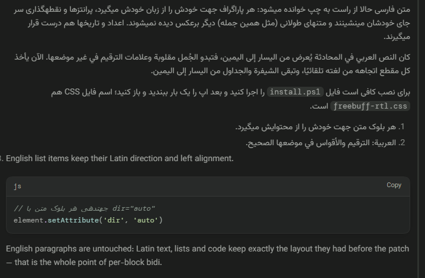

# Freebuff Desktop RTL + Persian Font Patch

**راست‌به‌چپ برای چت Freebuff دسکتاپ** — متن فارسی و عربی از راست به چپ و درست خوانده می‌شود؛
کد، جدول و بقیهٔ رابط دست‌نخورده می‌مانند. نصب: [نصب (فارسی)](#نصب-فارسی).

Community patch for [Freebuff Desktop](https://freebuff.com) (Electron, Windows) that makes
chat text render right-to-left correctly for Persian (Farsi), Arabic, Urdu and Hebrew —
while code blocks, tables, paths and the rest of the UI stay untouched.

Upstream feature requests: freebuff GitHub issues **#948** and **#1397**.

## نمونه / Demo



Each paragraph resolves its own direction, list markers sit on the item's own side, and
code blocks stay left-to-right.

## نصب (فارسی)

از [Releases](https://github.com/AlirezaEtemadi12/freebuff-desktop-rtl/releases/latest) فایل
`freebuff-desktop-rtl-v1.0.0.zip` را دانلود و در یک پوشه استخراج کنید، سپس در همان پوشه
PowerShell را باز کنید و اجرا کنید:

```powershell
powershell -NoProfile -ExecutionPolicy Bypass -File .\install.ps1
```

بعد **Freebuff را کامل ببندید** (از سینی سیستم هم خارج شود) و دوباره باز کنید؛ تا این کار را
نکنید تغییری نمی‌بینید.

- دسترسی ادمین لازم نیست؛ پچ فقط فایل‌های نصب‌شده در `%LOCALAPPDATA%` را تغییر می‌دهد.
- حذف کامل: `uninstall.ps1` را به همین شکل اجرا کنید و یک بار ری‌استارت کنید.
- بعد از هر آپدیت اپ، `install.ps1` را دوباره اجرا کنید، یا یک‌بار خودکارسازی را نصب کنید
  (بخش «After a Freebuff app update» در ادامه).
- اگر اپ در مسیر غیرمعمولی نصب است: `-UiPath "D:\Freebuff\resources\orchestrator\ui"`.

## What it does

- **Per-paragraph auto direction** in chat messages: a paragraph whose text starts with a
  strong RTL character (Persian/Arabic/Hebrew) is laid out RTL with correct punctuation and
  parentheses; English paragraphs stay LTR. Implemented with `unicode-bidi: plaintext` on
  message paragraphs plus a tiny same-origin script that sets `dir="auto"` on each text
  block (including list items — pure CSS cannot put the list bullet/number on the item's
  own side).
- **Code stays LTR**: inline code, code blocks, tables and diffs are bidi islands.
- **Composer / queued-prompt edit box / Steer box**: each **typed line** picks its own
  direction and alignment (`dir="auto"` + `unicode-bidi: plaintext`), so you can mix an
  English line and a Persian line in one message and each sits on its own side.
- **Persian font**: chat text uses [Vazirmatn](https://github.com/rastikerdar/vazirmatn)
  (variable weight 100–900, SIL OFL 1.1), served from the app's own origin (`127.0.0.1`)
  with no internet or CDN dependency. The `@font-face` is scoped with `unicode-range` to
  Arabic-script code points, so Persian/Arabic glyphs come from Vazirmatn while Latin text
  keeps the original Google Sans. Code keeps DM Mono; sidebar/buttons are untouched.

## Requirements & scope

- Windows (any modern Win10/11) — the patch edits files under `%LOCALAPPDATA%`, **no admin needed**.
- Scope is chat message text + text inputs only. No app-wide mirroring, no profile changes,
  no dependency on network at runtime.

## Install (English)

Download `freebuff-desktop-rtl-v1.0.0.zip` from
[Releases](https://github.com/AlirezaEtemadi12/freebuff-desktop-rtl/releases/latest), extract
it, then from that folder run:

```powershell
powershell -NoProfile -ExecutionPolicy Bypass -File .\install.ps1
```

Then fully close and reopen the Freebuff app (including the tray icon).

Optional switches:

```powershell
# app installed somewhere unusual (or Linux/macOS path when ported):
powershell -NoProfile -ExecutionPolicy Bypass -File install.ps1 -UiPath "D:\Freebuff\resources\orchestrator\ui"

# silent, for a Startup-folder .vbs:
powershell -NoProfile -ExecutionPolicy Bypass -File install.ps1 -Quiet
```

The installer:

1. Finds the app UI folder (`%LOCALAPPDATA%\Programs\@codebufffreebuff-desktop\resources\orchestrator\ui`).
2. Saves the untouched `index.html` as `index.html.freebuff-rtl.bak`.
3. Injects a `<style>` and a `<script src="/freebuff-rtl-user.js">` tag before `</head>`.
4. Copies `freebuff-rtl-user.js` and `Vazirmatn-Variable.woff2` next to it (served by the
   app's local server, so the app CSP accepts them).

Re-running the installer is safe — it refreshes the helper files and skips if already patched.
It also *does not* require admin and never touches your profile or settings.

## Uninstall

```powershell
powershell -NoProfile -ExecutionPolicy Bypass -File uninstall.ps1
```

It removes exactly the injected `<!-- freebuff-rtl-user-patch -->` / `<style>` / `<script>`
block from the *current* `index.html`, then deletes the helper script and font. It does not
copy `index.html.freebuff-rtl.bak` back: after an app update that backup belongs to the
previous build, and restoring it would point the new build at stale asset hashes (blank
window). Same optional `-UiPath` / `-Quiet` switches apply.

## After a Freebuff app update

The updater rewrites `index.html` and wipes the patch. Just run `install.ps1` again and
restart the app. To never think about it, drop a one-line `.vbs` into your Startup folder:

```
' %APPDATA%\Microsoft\Windows\Start Menu\Programs\Startup\freebuff-rtl.vbs
CreateObject("Wscript.Shell").Run "powershell -NoProfile -ExecutionPolicy Bypass -File ""C:\path\to\this-kit\install.ps1"" -Quiet", 0, False
```

## Files

| File | Role |
|---|---|
| `freebuff-rtl.css` | the stylesheet injected into the app (`<style id="freebuff-rtl-user-patch">`) |
| `freebuff-rtl.js` | same-origin script (`/freebuff-rtl-user.js`) applying `dir="auto"` per text block, with a MutationObserver for React re-renders/streaming |
| `Vazirmatn-Variable.woff2` | chat font (SIL OFL 1.1 — see below) |
| `install.ps1` / `uninstall.ps1` | installer (`-UiPath`, `-Quiet`) / remover (strips the injected block from the current `index.html`) |
| `FONT-LICENSE` | Vazirmatn font license text |

## How it works (for reviewers)

The Freebuff Desktop renderer is served from `http://127.0.0.1:<port>` by a local Bun
orchestrator reading `resources\orchestrator\ui\` from disk. The app CSP allows
`script-src 'self'`, so a same-origin script file is permitted; inline style injection
passes because only `script-src` is locked down. The patch:

- `unicode-bidi: plaintext` on `.msg.assistant .prose :is(...)` and message/user bubbles —
  every paragraph resolves its own base level from its content.
- `dir="auto"` per text block — covers list-item markers and heading alignment per item.
- `[data-composer-input]` (contenteditable div, this build) + safety-net `.composer textarea`.
- `.qedit` and `.thread-detail-steer-input` (plain textareas) for the queued-prompt edit
  box and Steer box.
- LTR islands for `.md-*` code/table elements and `code`/`pre`.

Tested against the Windows build of Freebuff Desktop (October 2026 build) with mixed
Persian/English threads, lists, code fences and tables in both light and dark themes.

## Known limitations

1. An app update removes the patch until `install.ps1` is re-run.
2. If a future build renames CSS classes (`.prose`, `.msg`, `.md-code`, …), the affected
   rules silently stop matching — safe but a good bug report if you see it.
3. Standalone file paths and mixed Latin tokens inside Persian sentences follow standard
   Unicode bidi rules; some visual scrambling there is inherent, not a bug.

## License

- Patch code: MIT (see `LICENSE`).
- Vazirmatn font: SIL Open Font License 1.1 (see `FONT-LICENSE`) — © The Vazirmatn Project
  Authors (https://github.com/rastikerdar/vazirmatn).

---

## README بالعربية (مختصر)

رقعة مجتمعية لتطبيق [Freebuff](https://freebuff.com) المكتبي (Electron، ويندوز) تجعل نص
المحادثة يُعرض من اليمين إلى اليسار بشكل صحيح للفارسية والعربية والأردية والعبرية، مع
بقاء الشيفرة والجداول والمسارات من اليسار إلى اليمين، وبقاء بقية الواجهة (الشريط الجانبي،
الأزرار) دون تغيير.

- كل فقرة تأخذ اتجاهها من لغتها تلقائيًا (`dir="auto"` + `unicode-bidi: plaintext`)، فلا
  حاجة إلى إعداد لغة.
- صندوق الكتابة وصندوق تعديل الطلبات وصندوق Steer: كل سطر مكتوب يأخذ اتجاهه ومحاذاته
  الخاصة.
- خط Vazirmatn لنصوص العربية/الفارسية فقط (`unicode-range`)، والنص اللاتيني يبقى بخطه
  الأصلي. الخط يُخدَّم من داخل التطبيق، بلا إنترنت.

التثبيت: شغّل `install.ps1`، ثم أغلق التطبيق وأعد فتحه. الإزالة: `uninstall.ps1`.
بعد كل تحديث للتطبيق أعد تشغيل `install.ps1`. لا يحتاج إلى صلاحيات مدير.
